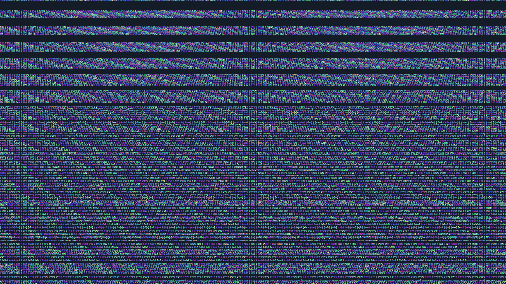
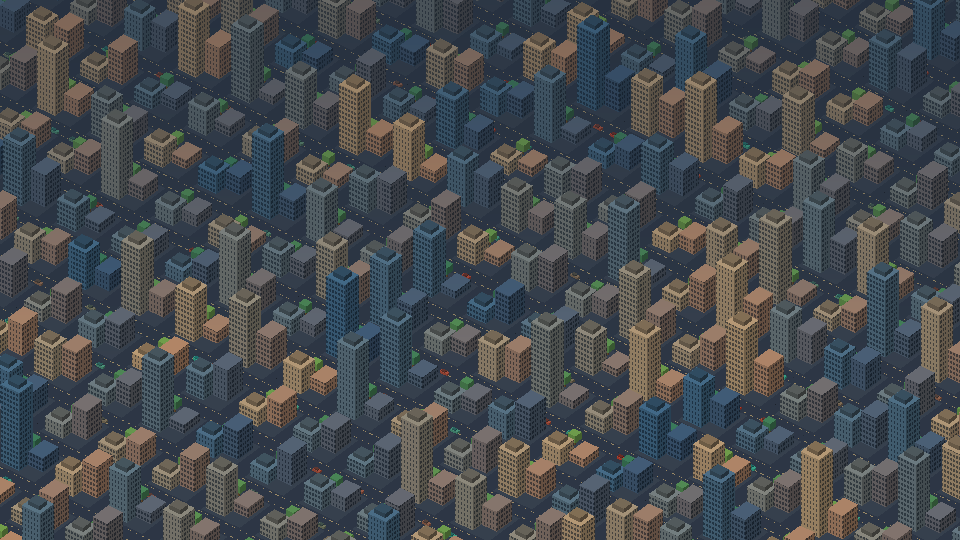

# VIctory-Navi10

VIctory-Navi10 is an independent, experimental Direct3D 12 graphics laboratory for AMD Navi 10. It measures how a GPU without native mesh shaders can generate geometry in compute, draw it indirectly, and keep its memory footprint predictable. The lab builds and runs with a procedural city and synthetic HLSL fixtures.

Full Xbox emulation is outside the project's scope. GTA VI has not been tested. The measurements below describe this laboratory.

The v0.3.0 candidate accepts versioned meshlet packets from an external translator. It supports indexed triangle geometry, flat per-primitive materials, perspective clipping and one to three frames in flight. The simulator and packet specification are the starting point for integrating another frontend. [Adapter](docs/translator-adapter.md) · [Scaling protocol](docs/scaling.md).



At 1 million candidate triangles and 720p, GPU geometry time fell from 38.52 ms to 4.59 ms in a controlled comparison of two compaction implementations. [Release measurements](docs/RELEASE-v0.3.0.md) · [Raw results](benchmarks/raw/v0.3.0/).



*Compute-generated geometry, 10,000 candidate objects, Radeon RX 5700 XT, 960 × 540. [See the 1,000-object capture](docs/images/city-1000.png).*

## Rendering paths

| Path | What runs |
| --- | --- |
| `direct` | `DrawInstanced` submits every object. The vertex shader generates geometry. |
| `indirect` | A compute shader performs frustum culling and compacts the visible object IDs. `ExecuteIndirect` draws the resulting instances. |
| `expanded` | Compute emits positions, per-quad attributes, indices, and the indexed draw arguments. A vertex shader reads the generated streams and the raster pipeline draws them through `ExecuteIndirect`. |

The expanded path assigns output space with an atomic counter. Four positions share one color, material, and face-normal record per quad. The draw reads the same position and attribute buffers that compute wrote. Direct3D 12 transitions put those buffers, the index buffer, and the indirect arguments into their respective read states before drawing. [Architecture](docs/architecture.md).

## Build and run

Use x64 Windows with Direct3D 12, PowerShell, and the x64 .NET Framework 4.x compiler `csc.exe` under `%WINDIR%\Microsoft.NET\Framework64\v4.0.30319`. Windows supplies the shader compiler `d3dcompiler_47.dll`. A Vulkan loader and driver are needed only for the optional capability probe. The build requires no package downloads.

The alpha ships as source. On the reference PC, Windows Application Control blocked a freshly compiled, unsigned executable. An earlier unsigned build passed verification on the same GPU. The exact policy decision remains unconfirmed. Keep Windows security protections enabled.

From the repository root:

```powershell
$exe = .\build.ps1
& $exe --probe --out .\runs
.\tests\verify.ps1 -Executable $exe
& $exe --test-meshlets --out .\runs\triangles
.\tests\translator.ps1 -Executable $exe
& $exe --meshlet-scale 100000 --meshlet-prefix --animate-tiles --frames-in-flight 2 --out .\runs\scale
& $exe --view --objects 10000
```

The preview uses WASD to move, Q/E to change elevation, arrow keys to rotate, and Tab to switch rendering paths. The benchmark renders off-screen.

```powershell
& $exe --objects 100000 --frames 150 --out .\runs\objects-100000
.\benchmarks\run.ps1 -Executable $exe -Frames 150 -StabilityFrames 2000
```

Use `--path direct`, `--path indirect`, or `--path expanded` to isolate one path. The test script accepts `-Warp` for software verification.

## Measured on RX 5700 XT

Reference system: Sapphire Nitro+ Radeon RX 5700 XT with 8 GB VRAM, Intel Core i5-9600K with six cores and six threads, 16 GB DDR4, and Windows build 26300. The AMD driver reported Direct3D feature level 12_1, Shader Model 6.8, Mesh Shader Tier 0, and Raytracing Tier 0. [Recorded hardware probe](benchmarks/raw/compact/capabilities.json).

Mean frame time at 960 × 540, in milliseconds. Each row uses 150 samples per path after 20 warmup frames.

| Objects | Direct | Cull + indirect | Generate + indexed indirect |
| ---: | ---: | ---: | ---: |
| 1,000 | 0.138 | 0.161 | 0.169 |
| 10,000 | 0.209 | 0.174 | 0.201 |
| 50,000 | 0.634 | 0.194 | 0.224 |
| 100,000 | 1.199 | 0.225 | 0.240 |

The expanded path used the same scene and settings before and after splitting positions from shared quad attributes. This A/B comparison used 1,000 samples per run in A/B/B/A order.

| Expanded path at 100,000 objects | Before | After |
| --- | ---: | ---: |
| Peak process-local video memory | 95.21 MiB | 58.71 MiB |
| GPU compute pass | 0.070 ms | 0.042 ms |
| Mean frame time | 0.285 ms | 0.249 ms |

All 24 image comparisons across the four object counts matched the direct path exactly. The longer run completed 6,000 frames at 100,000 objects, 2,000 per path, with no reported device failure or invalid geometry counters. [Protocol and raw results](benchmarks/README.md).

## Current limits

The city expansion shader targets fixed quad-based meshlets and an orthographic camera. The packet renderer accepts one opaque triangle-list draw with a fixed attribute layout. General shader translation, amplification shaders and in-process integration into VIctory remain research goals. The renderer uses one direct queue. Hardware wave selection is driver-controlled. [Protocol](benchmarks/README.md).

## Contribute

Direct3D 12 and shader translation contributors and RDNA 1 owners are welcome. Independent verification on another card or driver is a useful first contribution. Start with [CONTRIBUTING.md](CONTRIBUTING.md) and the [roadmap](ROADMAP.md).

[MIT license](LICENSE) · [Provenance](docs/provenance.md) · [Release notes](docs/RELEASE-v0.1.0-alpha.md)
